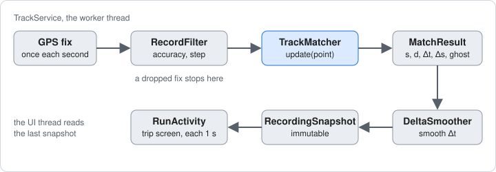
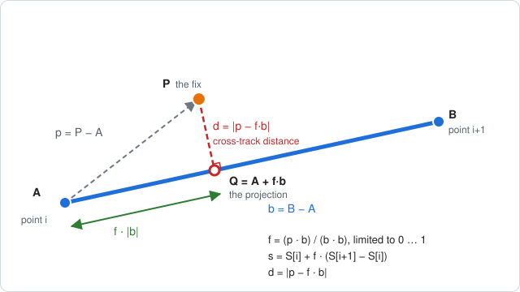
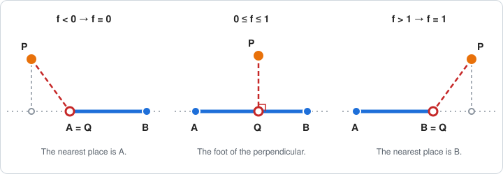
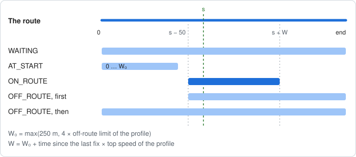
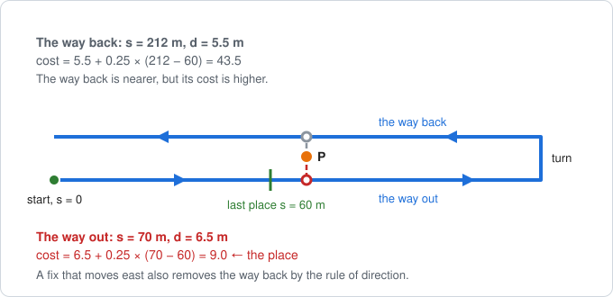
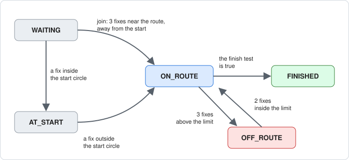
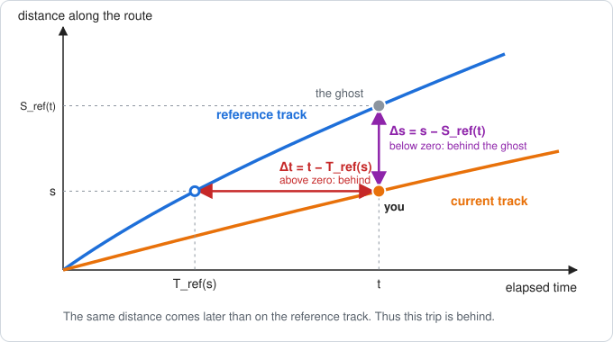

# How Retrace compares a trip with the reference track

This document tells how Retrace finds your position on the reference track and how it calculates the comparison values. It gives the math, the code that does each step, and worked examples.

The plan in [PLAN.md](PLAN.md) gives the rules in short form, in section 5.4. This document gives the reasons and the math behind them. The terms agree with [TERMINOLOGY.md](TERMINOLOGY.md). This document uses ASD-STE100 Simplified Technical English.

---

## 1. The code



| Class | Package | Task |
| --- | --- | --- |
| `TrackService` | `net.basov.retrace` | Gets each fix on its worker thread. Gives the fix to the filter, the matcher and the smoother. |
| `RecordFilter` | `core` | Drops a fix with a bad accuracy, an old time, or a step below the minimum distance. |
| `TrackMatcher` | `core` | Compares one point of the current track with the reference track. This document is mostly about this class. |
| `MatchResult` | `core` | The result for one point. It is immutable. |
| `DeltaSmoother` | `core` | Smooths the time difference for the screen. |
| `Geo` | `core` | The distance between two positions on the Earth. |
| `ReferenceSelector` | `core` | During the automatic selection, it runs one `TrackMatcher` for each candidate. See section 5.5 of the plan. |
| `Profile` | `core` | The limits of walking, running, cycling and driving. See section 11. |

The package `core` imports no Android package. Thus the tests run all of this math on the JVM.

A fix that the filter drops does not go to the matcher. Thus "the point" and "the fix" are the same thing in the rest of this document.

For a trip in the opposite direction, `Track.reversed()` turns the reference track around before the matcher gets it. The matcher then works as usual.

---

## 2. The symbols

| Symbol | Meaning | Unit |
| --- | --- | --- |
| `P` | The position of the current fix. | latitude, longitude |
| `i` | The index of a point of the reference track. | — |
| `A`, `B` | Point `i` and point `i+1`. They are the two ends of segment `i`. | latitude, longitude |
| `S[i]` | The distance along the route of point `i`. `S[0] = 0`. | m |
| `T[i]` | The time of point `i`. | ms |
| `s` | Your distance along the route: the place of your projection on the route. | m |
| `d` | The cross-track distance: the distance from `P` to the route. | m |
| `t` | Your elapsed time. | ms |
| `T_ref(s)` | The time that the reference track needed from its start to `s`. | ms |
| `S_ref(t)` | The distance along the route of the reference track at the elapsed time `t`. This is the place of the ghost. | m |
| `Δt` | The time difference. | ms |
| `Δs` | The distance difference. | m |
| `m` | The direction of your movement, as a unit vector. | — |

---

## 3. The preparation of the reference track

The constructor of `TrackMatcher` prepares the reference track once. It does these steps:

1. It smooths the points. Each point becomes the mean of the points within 10 m along the raw track (`SMOOTH_M`). The first point and the last point stay as they are.
2. It calculates `S[i]` along the smoothed points with the haversine formula. `S` of the last point is the length of the route.
3. It checks the times. Each point must have a time, and no time can be earlier than the time before it. Otherwise the track has no time values, and the matcher gives `s` and `d` only.
4. It finds the start of the reference track. This is the last point before the track leaves its start circle, at the radius of the profile. `T_ref` counts from that point. Thus a wait at the start of the reference track does not count.
5. It finds the finish place. From the end, it goes back while the points are inside the finish circle. The finish place is `S` of the earliest of these points. This is the place where the reference track enters the finish circle.

Why the smoothing: GPS noise gives a recorded track a small zigzag. The zigzag makes the distance along the track too large. The mean of the points within 10 m removes most of the zigzag. At a corner, the smooth route moves some meters inside the corner. That is much less than the off-route limit.

The smoothing uses a window that moves along the track. Each point goes into the sums once and out of the sums once. Thus the work is linear in the number of points.

---

## 4. Distances on the Earth

### 4.1 The distance between two positions

`Geo.distanceM` uses the haversine formula on a sphere with the mean radius of the Earth, `R = 6 371 008.8 m`:

```
φ1, φ2 = the latitudes in radians
Δφ = φ2 − φ1
Δλ = the difference of the longitudes in radians

a = sin²(Δφ / 2) + cos φ1 · cos φ2 · sin²(Δλ / 2)
distance = 2 · R · asin(√a)
```

The sphere has an error below 0.5 % against the real shape of the Earth. That is much less than the error of a GPS fix.

### 4.2 A flat plane at each segment

The projection onto a segment needs vectors in meters. `TrackMatcher` uses a flat plane at point `A` of each segment. The plane has `A` at its origin, `x` to the east and `y` to the north:

```
k = R · π / 180 = 111 195 m for each degree

x = (longitude − longitude of A) · cos(latitude of A) · k
y = (latitude − latitude of A) · k
```

Example: at the latitude 55.75°, a step of 0.0001° to the east is 6.258 m. A step of 0.0001° to the north is 11.120 m.

The plane has a small error, because the Earth is not flat. At the latitude 60°, the error is 4 mm for a distance of 300 m and 10 cm for 1.4 km. A segment of a track is short, and the off-route limit is some tens of meters. Thus the error has no effect.

The plane does not work across the 180° meridian. Retrace does not support a route over that meridian.

---

## 5. The distance from a point to a segment

This is the base step of the matcher. `TrackMatcher.projectOnSegment` does it for each segment in the search window.



### 5.1 The steps

1. Put `A`, `B` and `P` into the plane of `A`. See section 4.2. Then `A = (0, 0)`.
2. Calculate the vector of the segment, `b = B − A`, and the vector to the fix, `p = P − A`.
3. Calculate the part of the segment up to the foot of the perpendicular:

   ```
   f = (p · b) / (b · b)
   ```

   Here `·` is the dot product: `(x1, y1) · (x2, y2) = x1·x2 + y1·y2`.
4. Limit `f` to the range 0 to 1. See section 5.3.
5. Calculate the projection `Q = A + f·b`. This is the nearest position on the segment to `P`.
6. Calculate the cross-track distance `d = |p − f·b|`. Here `|v|` is the length of the vector `v`.
7. Calculate the distance along the route of `Q`:

   ```
   s = S[i] + f · (S[i+1] − S[i])
   ```

8. If the direction of movement `m` is known, calculate the cosine between the segment and the movement:

   ```
   cos = (b · m) / |b|
   ```

   `m` has the length 1. Thus `cos` is between −1 and 1. A value of 1 means that the segment and the movement have the same direction.

### 5.2 Why the formula is correct

The dot product of two vectors is `p · b = |p| · |b| · cos α`. Here `α` is the angle between them. Thus:

```
f · |b| = (p · b) / |b| = |p| · cos α
```

`|p| · cos α` is the length of the shadow of `p` on the line through `A` and `B`. Thus `f · |b|` is the distance from `A` to the foot of the perpendicular. `f` is the same distance as a part of the segment length.

The vector from `Q` to `P` is `p − f·b`. It is perpendicular to the segment, because its dot product with `b` is zero:

```
(p − f·b) · b = p · b − f · (b · b) = p · b − p · b = 0
```

A segment with the length zero has `b · b = 0`. The code then sets `f = 0`. Thus `Q = A` and `d = |p|`.

### 5.3 The limit of f

The foot of the perpendicular can be on the line through `A` and `B`, but outside the segment. Then the nearest position on the segment is an end point.



| Value of `f` | Position of the foot | Nearest position `Q` |
| --- | --- | --- |
| `f < 0` | before `A` | `A`, with `f = 0` |
| `0 ≤ f ≤ 1` | on the segment | the foot of the perpendicular |
| `f > 1` | after `B` | `B`, with `f = 1` |

Without the limit, `s` could be before the start of the segment or after its end. Also `d` would be the distance to the line, not to the segment. That distance is too small for a fix that is far beyond an end of the segment.

### 5.4 Worked example

The plane has a unit of 1 m. The segment goes from `A = (0, 0)` to `B = (40, 30)`. The fix is `P = (10, 20)`. The distances along the route are `S[i] = 120` and `S[i+1] = 170`.

```
b = (40, 30)          b · b = 40·40 + 30·30 = 2500      |b| = 50
p = (10, 20)          p · b = 10·40 + 20·30 = 1000

f = 1000 / 2500 = 0.4                 (inside 0 … 1, no limit)
Q = (0.4·40, 0.4·30) = (16, 12)
p − f·b = (10 − 16, 20 − 12) = (−6, 8)
d = √(36 + 64) = 10 m
s = 120 + 0.4 · (170 − 120) = 140 m
```

A second fix `P = (−12, 9)` is before `A`:

```
p · b = −12·40 + 9·30 = −210
f = −210 / 2500 = −0.084   →   limit   →   f = 0
Q = A = (0, 0)
d = √(144 + 81) = 15 m
s = S[i] = 120 m
```

If you move to the west, `m = (−1, 0)`. Then `cos = (40·(−1) + 30·0) / 50 = −0.8`. The segment goes against the movement. Section 6.3 tells what follows from that.

### 5.5 The code

```java
private void projectOnSegment(int i, double plat, double plon, int k) {
    double scale = Math.cos(Math.toRadians(lat[i])) * METERS_PER_DEGREE;
    double bx = (lon[i + 1] - lon[i]) * scale;
    double by = (lat[i + 1] - lat[i]) * METERS_PER_DEGREE;
    double px = (plon - lon[i]) * scale;
    double py = (plat - lat[i]) * METERS_PER_DEGREE;
    double length2 = bx * bx + by * by;
    double f = length2 > 0 ? (px * bx + py * by) / length2 : 0;
    f = Math.max(0, Math.min(1, f));
    double dx = px - f * bx;
    double dy = py - f * by;
    crossBuffer[k] = Math.sqrt(dx * dx + dy * dy);
    placeBuffer[k] = along[i] + f * (along[i + 1] - along[i]);
    double length = Math.sqrt(length2);
    directionBuffer[k] = Double.isNaN(moveX) || length == 0
            ? Double.NaN : (bx * moveX + by * moveY) / length;
}
```

| Code | Symbol |
| --- | --- |
| `bx`, `by` | `b` |
| `px`, `py` | `p` |
| `length2` | `b · b` |
| `dx`, `dy` | `p − f·b` |
| `crossBuffer[k]` | `d` |
| `along[i]` | `S[i]` |
| `placeBuffer[k]` | `s` of the segment |
| `moveX`, `moveY` | `m` |
| `directionBuffer[k]` | `cos` |

The code uses the squared length `b · b`. Thus it needs no square root for `f`.

---

## 6. From the segments to the place on the route

The projection gives one result for each segment. `TrackMatcher.search` selects one of them. The result is the new `s` and its `d`.

### 6.1 The search window

The matcher does not look at the whole route for each fix. It looks at a window of the route. The window depends on the state. Section 7 gives the states.



| State | Window | Selection |
| --- | --- | --- |
| `WAITING` | the whole route | the nearest segment |
| `AT_START` | `0` to `W₀` | the lowest cost, from `s = 0` |
| `ON_ROUTE` | `s − 50 m` to `s + W` | the lowest cost, from the last `s` |
| `OFF_ROUTE` | first `s − 50 m` to the end, then the whole route | the lowest cost, from the last `s` |

```
W₀ = max(250 m, 4 × off-route limit of the profile)
W  = W₀ + (time since the last fix) × (top speed of the profile)
```

The time since the last fix has a limit of 10 minutes. `W₀` is 250 m for each profile at this time.

Why a window: a route can come back near the same place, for example out and back, or on a loop. The window removes the far parts of the route. It also keeps the work small. The window grows after a gap in the fixes, because you can move far during a gap.

Why 50 m back: GPS noise can move the projection back a little. The window accepts that.

The first segment of the window comes from a binary search over `S`. See `TrackMatcher.segmentAt`. Then the search projects the fix onto each segment up to the end of the window.

### 6.2 The nearest segment

In the state `WAITING`, the matcher takes the segment with the lowest `d`. The matcher also uses this result if no local minimum passes the rules of section 6.3.

### 6.3 The local minimums and the cost

On a route out and back, two legs can be equally near a fix. Then the nearest segment can be on the wrong leg. A jump to the wrong leg gives a wrong `s`, and a wrong `Δt`.

The search uses this procedure:

1. Look at the `d` of the segments in their sequence along the route. Segment `k` is a local minimum if `d[k] ≤ d[k−1]` and `d[k] ≤ d[k+1]`. The first and the last segment of the window have one neighbor only. Each leg near the fix gives one local minimum.
2. Remove a local minimum with `d` above the off-route limit.
3. Remove a local minimum on a segment with `cos < −0.5`. That segment goes against your movement by more than 120°.
4. Remove a local minimum with `s` before the start of the window.
5. Calculate the cost of each local minimum that stays:

   ```
   step = s[k] − s(last)

   cost = d[k] + 0.25 · step       if step ≥ 0   (forward)
   cost = d[k] + 1.0 · (−step)     if step < 0   (back)
   ```

6. Take the local minimum with the lowest cost.

A trip moves forward along the route. Thus a step back costs four times more than a step forward. A step forward has a small cost too. Thus a far leg of the route loses against a near leg with the same `d`.



Worked example: the figure has a route out and back with 12 m between the legs. The last `s` is 60 m on the way out. The new fix is 6.5 m from the way out and 5.5 m from the way back.

| Leg | `s` | `d` | `step` | Cost |
| --- | --- | --- | --- | --- |
| the way out | 70 m | 6.5 m | +10 m | 6.5 + 0.25 × 10 = **9.0** |
| the way back | 212 m | 5.5 m | +152 m | 5.5 + 0.25 × 152 = 43.5 |

The way back is nearer, but the way out has the lower cost. Thus `s` becomes 70 m. If you move to the east, step 3 also removes the way back. A test with these positions on the real `TrackMatcher` gives `s = 70.0 m` and `d = 6.50 m`.

### 6.4 The direction of movement

The rule of direction needs `m`. `TrackMatcher.updateMovement` calculates it:

1. Keep one fix as the anchor.
2. Calculate the vector from the anchor to the new fix in the plane of the anchor.
3. If the vector is shorter than 3 m (`MIN_MOVEMENT_M`), stop. Keep the last `m`.
4. Otherwise, divide the vector by its length. The result is the new `m`. The new fix becomes the anchor.

Two fixes nearer than 3 m give mostly the direction of the GPS noise. Before the first movement of 3 m, `m` is not known, and step 3 of section 6.3 removes nothing.

---

## 7. The states



Each fix gets two limits. Both limits grow with the accuracy of the fix:

```
off-route limit = off-route distance of the profile + 2 × accuracy
circle radius   = radius of the profile + 2 × accuracy
```

Both tracks have GPS noise. Thus two tracks of the same route can lie some meters apart. The term `2 × accuracy` gives space for the noise of the two tracks. Without it, a city with poor GPS gives a false off-route state, or a trip that does not finish.

| State | Meaning | Change |
| --- | --- | --- |
| `WAITING` | The trip is not near the route yet. | A fix inside the start circle gives `AT_START`. Three fixes in sequence near the route, away from the start, give `ON_ROUTE`. |
| `AT_START` | The trip is inside the start circle. | The first fix outside the start circle gives `ON_ROUTE`. |
| `ON_ROUTE` | The comparison runs. | Three fixes in sequence above the off-route limit give `OFF_ROUTE`. The finish test gives `FINISHED`. |
| `OFF_ROUTE` | The fix is far from the route. | Two fixes in sequence inside the off-route limit give `ON_ROUTE`. |
| `FINISHED` | The trip reached the finish. | No change. Each later fix gets the result of the finish. |

### 7.1 The start at the start of the route

The trip starts when it leaves the start circle. The matcher then searches from `s = 0` to `W₀`. If `d` is inside the limit, `s` is the place of the search. Otherwise `s = 0`. The start time of the trip is:

```
trip start = time of the fix − T_ref(s)
```

Thus `Δt` starts at zero. The size of the start circle has no effect on `Δt`.

### 7.2 The join away from the start

A trip can start in the middle of the route, or after a GPS error at the start. In the state `WAITING`, each fix goes to the nearest segment of the whole route. A fix counts if `d` is inside the off-route limit and `s` is more than the circle radius from the start. After three such fixes in sequence (`JOIN_FIXES`), the trip joins the route at the `s` of the last fix. The start time of the trip uses the formula of section 7.1. Thus `Δt` also starts at zero after a join.

### 7.3 The change between on route and off route

In the state `ON_ROUTE`, a fix above the limit does not change `s`. One bad fix thus has no effect. After three bad fixes in sequence, the state is `OFF_ROUTE`.

In the state `OFF_ROUTE`, the matcher first searches the rest of the route. Thus a short cut that comes back to the route later works. If that search finds nothing inside the limit, the matcher searches the whole route. After two good fixes in sequence, the state is `ON_ROUTE`, and `s` is the place of the last fix.

---

## 8. The comparison values



The figure shows the two tracks as curves of the distance along the route against the elapsed time. Your fix is the point `(t, s)`. The two values look at the gap between the curves in two directions:

- `Δt` is the horizontal gap. It compares the times at the same distance.
- `Δs` is the vertical gap. It compares the distances at the same time.

### 8.1 The elapsed time

```
t = time of the fix − trip start
```

Section 7 gives the trip start.

### 8.2 The time of the reference track at s

`TrackMatcher.referenceTimeAt` finds segment `i` with `S[i] ≤ s < S[i+1]` with a binary search. Then it interpolates on the segment:

```
f = (s − S[i]) / (S[i+1] − S[i])
T_ref(s) = T[i] + f · (T[i+1] − T[i]) − start time of the reference track
```

### 8.3 The time difference

```
Δt = t − T_ref(s)
```

A value below zero means ahead. A value above zero means behind. The trip screen shows `Δt` after the smoothing of section 10.

### 8.4 The ghost and the distance difference

`TrackMatcher.referenceAlongAt` finds the place of the reference track at your elapsed time. It finds point `i` with `T[i] ≤ T < T[i+1]` with a binary search. Here `T` is the start time of the reference track plus `t`. Then it interpolates:

```
f = (T − T[i]) / (T[i+1] − T[i])
S_ref(t) = S[i] + f · (S[i+1] − S[i])

Δs = s − S_ref(t)
```

A value above zero means ahead of the ghost. The map shows the ghost at `S_ref(t)`. `TrackMatcher.positionAt` gets its latitude and longitude with the same interpolation on the segment.

### 8.5 The speeds

Your speed is the change of `s` in the smoothing window of the profile:

```
your speed = (s(now) − s(window start)) / (time now − time of the window start)
```

The matcher keeps the pairs of time and `s` of the last points for this. The speed of the reference track uses the same window at the same place:

```
reference speed = (s − S_ref(T_ref(s) − window)) / window
```

Both speeds are along the route. Thus a zigzag across the route does not make your speed too large.

### 8.6 The time of arrival

```
ratio = t / T_ref(s), limited to 0.25 … 4
predicted time = t + (T_total − T_ref(s)) × ratio
```

`T_total` is the time of the whole reference track. The ratio applies after 30 s of the reference track. Before that, the ratio is 1. One slow start would make the prediction too large.

Example: `t = 600 s`, `T_ref(s) = 540 s` and `T_total = 1200 s`. Then `ratio = 1.111`, and the predicted time is `600 + 660 × 1.111 = 1333 s`.

### 8.7 A reference track with no times

A GPX file from a different application can have no times. Then the matcher gives `s`, `d`, the elapsed time and your speed. Each time value is `MatchResult.UNKNOWN`, and each speed of the reference track is `NaN`.

---

## 9. The finish

`TrackMatcher.afterMove` checks the finish after each fix in the state `ON_ROUTE`. The trip finishes if one of these conditions is true:

1. `s ≥ finish place − radius of the profile`, and the fix is inside the finish circle.
2. `s ≥ length of the route − circle radius`.

The first condition is the usual finish. The place condition stops a false finish on a loop, where the start and the finish are at the same place. The second condition helps when GPS drift moves `s` along the route by some meters.

At the finish, the matcher keeps the result. The finish time is the elapsed time of the first fix of the finish. Then `Δt` is the exact result, with no smoothing.

---

## 10. The smoothing for the screen

`Δt` has GPS noise. At walking speed, it moves by some seconds from one fix to the next. `DeltaSmoother` gives the screen an exponential mean:

```
w = 1 − exp(−(time since the last value) / τ)
value = value + w · (Δt − value)

τ = 2 × smoothing window of the profile
```

Example: for walking, the window is 15 s. Thus `τ = 30 s`. A fix one second after the last fix moves the value by `w = 0.0328` of the difference.

The weight grows with the time since the last value. Thus a fix after a long gap moves the value more. The service starts the smoothing again at the start, at a join, and at a change of the temporary reference track.

The smoothing removes only the fast part of the noise. The slow GPS drift of the two trips stays. See section 12.

---

## 11. The values of the profiles

The values are in `Profile.java`.

| Profile | Accuracy limit | Minimum distance | Off-route distance | Smoothing window | Radius | Top speed |
| --- | --- | --- | --- | --- | --- | --- |
| walking | 20 m | 2 m | 25 m | 15 s | 15 m | 3 m/s |
| running | 25 m | 3 m | 30 m | 10 s | 20 m | 7 m/s |
| cycling | 30 m | 5 m | 40 m | 8 s | 25 m | 20 m/s |
| driving | 50 m | 10 m | 60 m | 5 s | 40 m | 50 m/s |

The constants of `TrackMatcher`:

| Constant | Value | Use |
| --- | --- | --- |
| `SMOOTH_M` | 10 m | The smoothing of the reference track. Section 3. |
| `BACK_TOLERANCE_M` | 50 m | The window back from `s`. Section 6.1. |
| `FORWARD_COST`, `BACK_COST` | 0.25, 1.0 | The cost of each meter. Section 6.3. |
| `MIN_DIRECTION` | −0.5 | The cosine of 120°. Section 6.3. |
| `MIN_MOVEMENT_M` | 3 m | The direction of movement. Section 6.4. |
| `MAX_GAP_MS` | 10 min | The limit of the gap for the window. Section 6.1. |
| `JOIN_FIXES` | 3 | The join. Section 7.2. |
| `OFF_ROUTE_FIXES` | 3 | On route to off route. Section 7.3. |
| `BACK_ON_ROUTE_FIXES` | 2 | Off route to on route. Section 7.3. |
| `MIN_RATIO_TIME_MS` | 30 s | The time of arrival. Section 8.6. |
| `MIN_PACE_RATIO`, `MAX_PACE_RATIO` | 0.25, 4 | The time of arrival. Section 8.6. |

---

## 12. The limits of the precision

The precision of `Δt` has a limit. The GPS error of a fix has a slow part, the drift. The drift changes over minutes, and it is different on two trips. Thus the two tracks differ along the route by about `σ × √2`. Here `σ` is the size of the drift of one track.

At walking speed, about 1.4 m/s, this gives about 4 s for `σ = 4 m` and about 8 s for `σ = 8 m`. At a higher speed, the same distance is a shorter time. Thus the error is smaller for running, cycling and driving.

No smoothing can remove the drift, because it is slow. A way helps. It is the mean of some tracks, thus its drift is smaller. See section 5.8 of the plan.

---

## 13. The tests

The tests of this math are in `test/java/net/basov/retrace/core/`:

- `TrackMatcherTest` runs the matcher on invented tracks. The routes are a straight line, a route with corners, a route out and back, a loop and a figure eight. Other tests have a join, a wait at the start, a GPS gap and a route with no times.
- `DeltaSmootherTest` checks the smoothing.
- `ReferenceSelectorTest` checks the automatic selection with many matchers.

`TestTracks` makes the invented tracks. It adds noise with a slow drift and a fast part, the same as a real GPS receiver. The tests use no real track.
